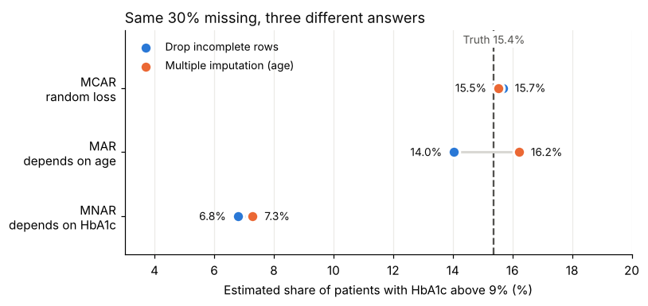

# Missing data is rarely random

A short, reproducible example of the three missing-data mechanisms (MCAR, MAR and MNAR) using a simulated health-record dataset.



## The point in one table

5,000 simulated patients with diabetes. 30% of HbA1c results are missing in every scenario. The true share of patients with HbA1c above 9% is **15.4%**.

| Why values are missing | Drop incomplete rows | Multiple imputation (using age) |
| --- | --- | --- |
| MCAR: random sample loss | 15.7% | 15.5% |
| MAR: younger patients attend less | 14.0% | 16.2% |
| MNAR: poorly controlled patients skip follow-up | 6.8% | 7.3% |

Same amount of missing data, very different answers. Under MNAR, both methods miss more than half of the poorly controlled patients.

## What the notebook covers

1. Simulating MCAR, MAR and MNAR with the same missing rate
2. Complete-case analysis versus multiple imputation under each mechanism
3. Why MAR and MNAR can't be distinguished from the observed data alone
4. A delta-adjustment sensitivity analysis for the MNAR case

## Run it

```bash
pip install -r requirements.txt
jupyter notebook missing_data_is_rarely_random.ipynb
```

Or upload the `.ipynb` file to [Google Colab](https://colab.research.google.com).

## Data and assumptions

- All data is **synthetic**. Ages, HbA1c values, the age-HbA1c relationship and the 9% cut-off are illustrative assumptions, not clinical estimates.
- Sensitivity analysis follows the principle in [ICH E9(R1)](https://database.ich.org/sites/default/files/E9-R1_Step4_Guideline_2019_1203.pdf), the addendum on estimands and sensitivity analysis in clinical trials (Step 4, November 2019).

## Author

Yuktha, research ethics and health data science. https://www.linkedin.com/in/yukthashreenivasan/
